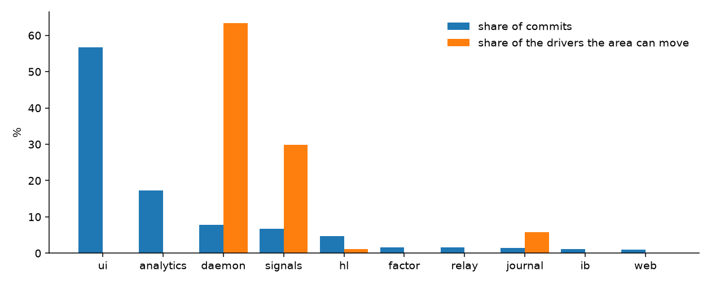
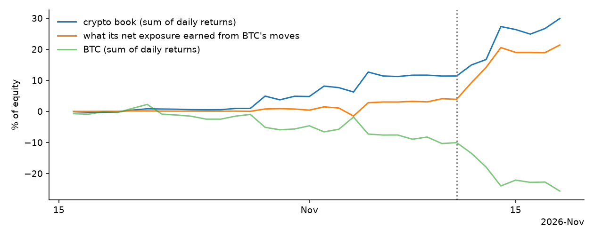

# Commits against risk and reward

Written by `python -m desk.commit_risk_reward run` (tiles: `publish`). Data: `desk/build_history.csv` (509 commits, 2026-10-16 to
2026-11-19), the books' daily series on desk trading equity, and the 30-day benchmark attribution.

**Power, up front.** The build covers 34 days. Eight of its ten rule changes landed in the last 8 days (from 2026-11-11),
so the only before/after test that can be run has one regime change and 8 days after it. Nothing below clears the desk's bar
(t of at least 2 and the same sign in both halves) for rule changes helping risk-adjusted return.

## A. Where the effort goes, and what it can move

| Area | Commits | Churn | Rule changes | Share of the drivers it can move | Which drivers | Evidence that its changes helped |
|---|---|---|---|---|---|---|
| ui | 57% | 38% | 0 | 0% | nothing directly | n/a |
| analytics | 17% | 12% | 0 | 0% | nothing directly | n/a |
| daemon | 8% | 14% | 9 | 63% | Sizing, Timing, Market exposure, Fees & funding, Drawdown and leverage | not established |
| signals | 7% | 9% | 0 | 30% | Picks, Timing, Market exposure | not established |
| hl | 5% | 13% | 0 | 1% | Fees & funding | not established |
| factor | 2% | 6% | 0 | 0% | nothing directly | n/a |
| relay | 2% | 1% | 0 | 0% | nothing directly | n/a |
| journal | 1% | 1% | 1 | 6% | Picks | not established |
| ib | 1% | 2% | 0 | 0% | nothing directly | n/a |
| web | 1% | 4% | 0 | 0% | nothing directly | n/a |

The "can move" mapping is a judgement (`DRIVERS` in `desk/commit_risk_reward.py`): Picks to signals and journal; Sizing to the
daemon; Timing and Market exposure to the daemon and signals; Fees & funding to the daemon and HL; drawdown and leverage to the
daemon. A driver's size is its absolute pp in the 30-day attribution (crypto and stocks averaged), and drawdown is the worst
fall since the build began; each driver is shared equally among the areas that can move it.

- **UI is 57% of commits and 38% of churn and moves no driver directly.** It works through decisions the desk then takes.
- **The daemon is 8% of commits and 63% of the outcome drivers.** Signals is 7% of commits and 30% of the drivers.

Crypto, 30 days (pp of equity): Picks 4.0, Sizing 2.8, Timing 15.5, Market exposure 36.7, Fees & funding -2.2.
Stocks: Picks -3.2, Sizing -0.9, Timing -0.9, Market exposure 1.7, Fees & funding 0.1. The stocks inputs moved between fetches a few minutes apart in the beta-weight test, so read the stocks parts loosely.

## B. Rule changes: before and after

Ten behaviour-changing commits (daemon rules, stops, auto-trading, sizing, guards, ladders, thesis rules), curated in `EVENTS`. Each has
other rule changes within 3 days, so no event has a clean window (last column):

| Date | Area | What changed | Other changes within 3 days |
|---|---|---|---|
| 2026-11-02 | daemon | Ladder orders (market making starts) | 1 |
| 2026-11-04 | daemon | Kill switch and execution quality | 1 |
| 2026-11-11 | daemon | Margin guard on account-wide liquidation risk; wider HL stops; conviction trades; ladders in the daemon | 3 |
| 2026-11-12 | daemon | Take-profits and ladder quotes held in daemon memory; per-coin ladder settings | 4 |
| 2026-11-13 | daemon | Fade entry modes (stop=none) | 5 |
| 2026-11-14 | journal | Auto-trading standing order: bank half of each crypto short in profit; regime-aware ladders | 6 |
| 2026-11-15 | daemon | Auto flatten on strong BTC momentum; auto trading follows the Binance replay; neutral ladders | 6 |
| 2026-11-16 | daemon | Build-ups to the full risk budget; unprotect drops stops and guards on directional positions | 5 |
| 2026-11-17 | daemon | Funding out of the risk cap; thesis entries beyond the cap; stop-free sizing | 4 |
| 2026-11-18 | daemon | No exchange stop-loss on new trades; half-Kelly batch execution | 3 |

Before and after 2026-11-11 (when the changes bunch):

| Book | Period | Days | Mean daily return | Daily vol | Mean / vol | Max drawdown | Net | Gross | Benchmark daily |
|---|---|---|---|---|---|---|---|---|---|
| Crypto | before | 26 | 0.44% | 1.68% | 0.26 | -1.9% | -0.23 | 0.39 | -0.40% |
| Crypto | after | 8 | 2.32% | 3.82% | 0.61 | -2.4% | -0.84 | 0.84 | -1.91% |
| Stocks | before | 26 | -0.40% | 1.91% | -0.21 | -11.8% | 0.69 | 0.74 | -0.10% |
| Stocks | after | 8 | -0.24% | 1.12% | -0.21 | -3.6% | 0.48 | 0.55 | -0.33% |

The crypto book's mean return rose from 0.4% to 2.3% a day, with vol up 2.3 times and gross exposure up 2.2 times, in a BTC that went
from -0.4% to -1.9% a day. That is a bigger bet in a falling market, not necessarily better rules. The test that separates them
regresses the daily return on what the net exposure going into the day should have earned (net weight x BTC's return) and a dummy
for the days from 2026-11-11; the dummy (`gamma`) is the extra daily return no exposure explains.

| Book | gamma, benchmark alone | gamma, exposure-matched | t | gamma, first / second half of the after days | Placebo: other splits as large | Verdict |
|---|---|---|---|---|---|---|
| Crypto | 2.19% | -0.08% | -0.2 | -1.13% / 0.37% | 99% of 351 | not established: t -0.2 below 2; the halves of the after period disagree; 99% of other splits are as large |
| Stocks | 0.03% | -0.00% | -0.0 | 0.04% / -0.04% | 100% of 619 | not established: t -0.0 below 2; the halves of the after period disagree; 100% of other splits are as large |

With the benchmark alone the crypto book looks like +2.2% a day (t 2.4). Once the exposure is controlled it is -0.08% (t -0.2):
most of the gain was the net short earning BTC's fall. The book did finish 8.5 pp (cumulative daily returns) above what its exposure earned, but
7.3 pp of that gap was already there before 2026-11-11, so the rule changes do not explain it. Other split dates give |t| up to 2.3, so the real split is not unusual.

## C. What is established and what is not

Established:
- The daily return of the crypto book tracks its exposure-weighted BTC move (matched beta 1.09): the P&L since the build is mostly Market exposure and Timing, not selection.
- Effort and outcome are far apart: most commits are UI, while the drivers sit in the daemon and signals.
- No rule change has a clean before/after window.

Not established (each fails t of at least 2 in both halves, or the placebo): that the rule changes raised risk-adjusted return, for crypto or stocks; that any single rule (auto flatten, build-ups, stop-free entries, ladders) helped or hurt.

## Focus, with the evidence level

1. **Keep rule changes apart and dated, then judge them one at a time.** Evidence: structural (none of the ten events has a clean window). Ship at most one behaviour change per week, label it `feat(daemon)`, and write down the expected effect on a named driver first.
2. **Test the daemon's rules on replays before live.** Evidence: structural. The daemon is the one area that moves sizing, timing, exposure and drawdown, and the live record cannot isolate its changes; replays can (as the Binance and stop replays did).
3. **Measure exposure-matched return as the desk's skill number.** Evidence: strong for crypto in this sample. Raw return flatters a bigger bet in a falling market (+2.2% a day raw against -0.08% matched).
4. **Spend less on UI polish unless it changes a decision.** Evidence: descriptive (UI is the largest share of commits and moves no driver directly). It is not evidence that the UI is worthless: the decision tools sit there.
5. **Fix the stocks inputs before reading the stocks book.** Evidence: the stocks Picks and Sizing moved between runs a few minutes apart in the beta-weight test, so no stocks conclusion above rests on them.

Revisit after 60 or more active days with at most one behaviour change per week.
