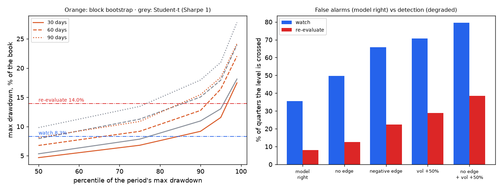

# Crypto drawdown: when should a breach make us re-evaluate the models?

Fitted 2026-11-20. Alert only, nothing trades on it. This is a model-health signal for the crypto book; it is not the investor's tolerance (`desk/fiduciary.json`), which is the desk's drawdown the investor accepts.

## What the data can and cannot support

- The crypto book has **35 managed days**. That is far too few to measure its own drawdown distribution, so the shape comes from a **proxy**, not from the book.
- The proxy replays **today's crypto positions** (net -17%, gross 99% of the HL wallets' equity, 10 coins) over **1079 days** of the HL candle panel (2023-11-16 to 2026-11-18). It leaves out funding, fees and trading in and out. Today's short book was picked with hindsight, so its replayed drift is **not used**: drift is assumed, and only volatility, tails and serial dependence come from the replay.
- Coins with under 90 days of history are replayed by the median coin: USELESS.
- **Assumed edge: an annualised Sharpe of 1** for a book whose model is right. This is an assumption for the user to confirm, not a measured number; the levels under Sharpe 0 and 2 are in the sensitivity table.

## Method

- Max drawdown over 30, 60 and 90 days, two ways: a **stationary block bootstrap** of the replayed returns (mean block 13 days, from the autocorrelation of the returns and of their absolute values) and a **Student-t** model (df 3.1, scaled to the current EWMA volatility, independent days).
- Percentile confidence intervals come from resampling the replay itself (the sampling uncertainty of the proxy, not of the positions or the models).
- The two levels are percentiles of the **one-quarter (63 days) max drawdown** under the assumed edge: **watch** is crossed in 35% of quarters by a book whose model is right, **re-evaluate** in 8%.

## Max drawdown distribution (Sharpe 1)

| Horizon | Model | p50 | p75 | p90 | p95 | p99 |
|---|---|---|---|---|---|---|
| 30 days | block bootstrap | 4.7% | 6.8% | 9.2% | 11.6% | 17.5% |
| 30 days | Student-t | 5.3% | 7.8% | 11.0% | 13.0% | 18.1% |
| 30 days | 90% interval (bootstrap) | 4% to 5% | 6% to 8% | 8% to 11% | 10% to 14% | 12% to 20% |
| 60 days | block bootstrap | 6.8% | 9.2% | 12.7% | 16.4% | 22.0% |
| 60 days | Student-t | 7.9% | 11.3% | 15.0% | 17.9% | 23.9% |
| 60 days | 90% interval (bootstrap) | 6% to 8% | 8% to 11% | 11% to 17% | 12% to 19% | 15% to 23% |
| 90 days | block bootstrap | 8.1% | 10.9% | 15.5% | 18.4% | 24.2% |
| 90 days | Student-t | 9.8% | 13.4% | 18.0% | 21.0% | 27.8% |
| 90 days | 90% interval (bootstrap) | 7% to 9% | 10% to 14% | 12% to 18% | 14% to 22% | 16% to 29% |

### Sensitivity to the assumed edge (60 days, block bootstrap)

| Assumed Sharpe | p50 | p75 | p90 | p95 | p99 |
|---|---|---|---|---|---|
| 0 (no edge) | 8.0% | 10.8% | 14.8% | 17.5% | 23.2% |
| 1 (assumed) | 6.8% | 9.2% | 12.7% | 16.4% | 22.0% |
| 2 | 5.8% | 8.0% | 10.7% | 14.7% | 21.2% |

## The two levels

| Level | Drawdown from the high | In book volatilities (sigma x sqrt(63)) | 90% interval of the proxy | Student-t level | Crossed in | 
|---|---|---|---|---|---|
| watch | 8.3% | 0.82 | 7.8% to 9.5% | 9.9% | 35% of quarters |
| re-evaluate | 14.0% | 1.38 | 12.1% to 17.0% | 16.2% | 8% of quarters |

**Best-supported range for the re-evaluate level: 12% to 17%** (the bootstrap's 90% interval; the Student-t model gives 16%); the monitor uses the bootstrap value. Both levels scale with the book's volatility: they are stored in units of its daily volatility times sqrt(63), and the monitor recomputes that volatility from today's positions on every run (today 1.27% a day), so adding exposure widens them and cutting exposure tightens them.

## False alarms and detection

| Book | Crossed watch in a quarter | Crossed re-evaluate in a quarter | Crossed watch in two quarters | Crossed re-evaluate in two quarters |
|---|---|---|---|---|
| model right | 36% | 8% | 64% | 21% |
| no edge | 50% | 13% | 80% | 36% |
| negative edge | 66% | 22% | 93% | 60% |
| vol +50% | 71% | 29% | 92% | 56% |
| no edge and vol +50% | 80% | 39% | 97% | 71% |

**Detection is weak.** A drawdown monitor is a poor test of whether the edge is still there: a book with no edge crosses the re-evaluate level in 13% of quarters, against 8% for one whose model is right. It is better at catching a volatility blow-up (vol +50%) or a negative edge. Treat a crossing as a prompt to look at the theses, sizing and regime, not as proof that a model failed, and a quiet period as saying little about the models.

## The crypto book so far

- 35 managed days: realised volatility 2.36% a day against 1.42% for today's positions replayed over the same days (correlation 0.20): the book carried more risk than today's positions, and the proxy is a rough guide to it.
- Its max drawdown so far is 2.4%, at the 8% percentile of the simulated max drawdown for that many days: shallow, with a mean of 0.83% a day that no sustained edge would deliver.

## Caveats

- The proxy replays today's positions, which include a short book chosen in a bear regime; real exposure changes through the period, funding and fees are left out, and the managed-era book was more volatile than the replay.
- The false-alarm rates assume the model is right at the assumed Sharpe and that days are exchangeable within blocks; regime changes break that, and a regime change is exactly what a crossing should prompt us to check.
- The drawdown is measured from the book's high-water mark since the managed era began, not a rolling quarter; the false-alarm rate is per quarter starting at a high, so a book already under water crosses sooner.
- Refit with `python -m desk.drawdown_monitor fit` as the managed history grows; with a year of managed days the book's own returns can replace the proxy.
