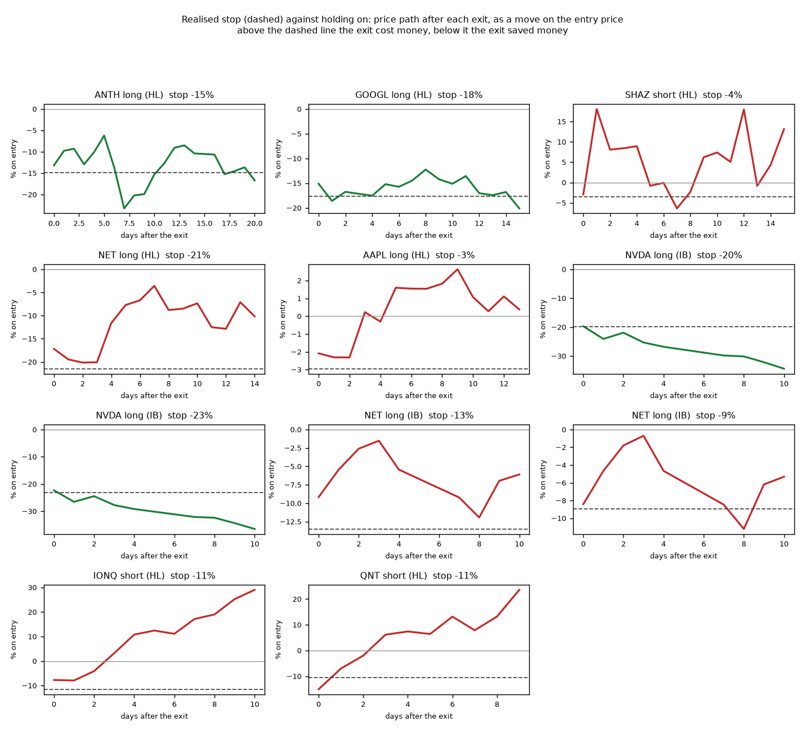

# Thesis review, 2026-11-19

Read-only: no order was sent and no setting changed. Thesis first: a loss on a position is a question about its thesis, not a reason to act.

## What the data says in short

- **GOOGL's and NET's stops went on late and tight.** On Hyperliquid their stop ladders (two or three rungs) were placed on 2026-11-02 about 3 to 8% from the price of the day, on positions that had already lost 18 to 20% from entry. The stops then realised that accumulated loss; they did not cause it (table 1). The shorts (SHAZ, QNT, RELIANCE) had theirs from entry, 2 to 14% away. IB's order types are not recorded, so its exits cannot be classed as stops.
- **Whether the exits sold a dislocation is not established.** Over 11 stopped names the price moved the thesis's way after the exit by +8.1% on average (t 1.6); first half +4.0% (t 0.8), second half +11.6% (t 1.4). That is under t of 2 and not in both halves, so it is a hypothesis, not a finding. Holding every exit to the latest close would have been $507 better than the -$686 realised, but the result is driven by the shorts. Prices are daily closes to 2026-11-19.
- **Longs and shorts differ, and the market explains most of it.** Stopped longs: -2.6% after the exit (t -0.6, n 5); stopped shorts: +15.0% (t 2.5, n 7; halves +8.9% t 1.3 and +19.6% t 2.1). The shorts were stopped before the sell-off ran (SPY -6.6% since 2026-11-04) and the longs before it went on falling, so one market move stands behind both: the names are not independent and the short result is not established either. GOOGL and NVDA kept falling after the exit (the stops helped); NET recovered (they cost).
- **Held positions:** none is intact on the price tests except NET; the rest are weakened, none broken. Market regime: SPY is 8.1% below its 250-day high, below its 50-day average, and the desk's equity sell-off read is high (4/4 signals, evidence 3 days only).

## 1. What the stops did (Hyperliquid, from the exchange's order history)

07f2's order history starts 2026-11-02 17:19, so only stops from then on can be seen. The mark is the 5-minute open when the first stop was placed; the stop distance is how far the stop sat against the position.

| Position | Placed (UTC) | Days held before | Mark then | Entry | Already lost before | Stop levels against the position |
|---|---|---|---|---|---|---|
| GOOGL long | 11-02 17:29 | 18 | 282.54 | 343.02 | -17.6% | 2.6%, 3.9% |
| SHAZ short | 11-03 20:02 | 0 | 23.81 | 23.79 | -0.1% | 4.7%, 9.2%, 13.7%, 13.8% |
| NET long | 11-02 21:02 | 7 | 265.85 | 333.73 | -20.3% | 3.0%, 5.6%, 8.2% |
| QNT short | 11-07 02:28 | 0 | 37.15 | 37.15 | +0.0% | 10.0% |
| RELIANCE short | 11-03 03:40 | 0 | 13.73 | 13.52 | -1.6% | 2.0%, 5.4%, 8.7% |

GOOGL had lost 18% over 18 days and NET had lost 20% over 7 days when their stops went on. Whatever the stops did after that, the thesis question belongs to the days before them: most of the loss was already there.

## 2. Position by position

Status uses only what price can test: the name's return less SPY's over 20 and 60 days, on the thesis side (within 2 points of SPY counts as neutral). **intact**: neither test is against; **weakened**: one is; **broken**: both are and the price is at its 60-day extreme against the thesis. What price cannot test: ads, compute, distribution and product quality are not visible in price. Source of each thesis in the last column; the journal holds crypto entries only.

| Name | Side | Held | Thesis | Stop realised | $ | Since exit | Exit saved/cost | Status | RS 20d | RS 60d | Beta | Source |
|---|---|---|---|---|---|---|---|---|---|---|---|---|
| NET | long | yes | High-beta tech long | -11.1% | -$233 | +9.0% | -$108 | intact | +13.5% | -0.1% | 2.3 | user 2026-11-19: still in thesis; no rationale recorded (verified stop) |
| AMD | long | yes | Compute: invisible supplier, conviction long | n/a | n/a | n/a | n/a | weakened | -1.3% | -9.7% | 3.7 | frame 2026-11-13 |
| GOOGL | long | yes | Tech long: ads and compute, big tech has both | -16.6% | -$106 | -5.2% | $36 | weakened | +2.7% | -16.0% | 1.1 | frame 2026-11-13; user: still in thesis 2026-11-19 (verified stop) |
| INTC | long | yes | Compute: invisible supplier, conviction long | n/a | n/a | n/a | n/a | weakened | -10.0% | -44.8% | 2.8 | frame 2026-11-13 |
| META | long | yes | Tech long: ads | n/a | n/a | n/a | n/a | weakened | +2.2% | -4.4% | 1.4 | frame (ads bucket); no entry note |
| MSFT | short | yes | Complacency short: monopoly, poor product, outages | n/a | n/a | n/a | n/a | weakened | +0.3% | +6.2% | 1.2 | frame 2026-11-13 |
| MU | long | yes | Tech long: compute (memory) | n/a | n/a | n/a | n/a | weakened | -16.7% | -26.0% | 2.9 | frame (compute bucket); no entry note |
| SP500 | long | yes | Index exposure (c248) | n/a | n/a | n/a | n/a | index: no relative test | n/a | n/a | n/a | no note recorded |
| AAPL | long | no | Tech long | -2.7% | -$23 | +3.3% | -$27 | intact | +7.0% | +10.9% | 0.6 | no entry note |
| ANTH | short | no | AI app, pre-IPO | -4.7% | -$6 | +7.4% | -$9 | intact | +1.2% | -16.7% | 1.5 | frame 2026-11-15 doubts unprofitable AI names; no entry note |
| IONQ | short | no | No thesis recorded in the repo | -11.5% | -$65 | +36.3% | -$228 | intact | -18.9% | -35.7% | 2.7 | none |
| QNT | short | no | No thesis recorded in the repo | -10.6% | -$21 | +30.9% | -$68 | intact | -11.2% | -39.5% | 2.8 | none (verified stop) |
| SHAZ | short | no | No thesis recorded in the repo | -3.5% | -$31 | +16.1% | -$145 | intact | -4.6% | -58.0% | 4.7 | none (verified stop) |
| SOFI | short | no | No thesis recorded in the repo | -5.2% | -$10 | +22.0% | -$44 | intact | -14.0% | -14.9% | 2.0 | none |
| ANTH | long | no | AI app, pre-IPO | -14.9% | -$80 | -2.1% | $10 | weakened | +1.2% | -16.7% | 1.5 | frame 2026-11-15 doubts unprofitable AI names; no entry note |
| NVDA | long | no | Compute: hardware presented appealingly | -21.5% | -$102 | -17.8% | $63 | broken | -23.4% | -28.3% | 1.6 | frame 2026-11-13 |
| JIO | short | no | No thesis recorded in the repo | -2.0% | -$6 | -2.5% | $8 | cannot test | +11.4% | n/a | n/a | none |
| RELIANCE | short | no | No thesis recorded in the repo | -4.0% | -$3 | -5.1% | $5 | cannot test | +23.4% | n/a | n/a | none (verified stop) |

*Since exit* is the side-adjusted move from the exit price to the latest close: positive means the price went the thesis's way after the exit. *Exit saved/cost* is that move in dollars on the exited size, negative when the exit cost money. KYIV and SWMR are symbolic holdings and left out.

What would change each held status: the 20 or 60-day relative strength crossing 2 points of SPY on the other side; broken needs the price at its 60-day low (long) or high (short) with both against. A thesis's own claims (ads, compute, distribution, outages) need evidence price does not give.

- **NET long** (intact): -13.9% on entry.
- **AMD long** (weakened): funding -4.9% a year to the position, -15.0% on entry.
- **GOOGL long** (weakened): -30.6% on entry.
- **INTC long** (weakened): funding -5.5% a year to the position, -7.3% on entry.
- **META long** (weakened): -20.0% on entry.
- **MSFT short** (weakened): funding +1.5% a year to the position, +2.9% on entry.
- **MU long** (weakened): -7.3% on entry.
- **SP500 long** (index: no relative test): funding -4.1% a year to the position, -4.4% on entry.

## 3. What holding would have meant

| Name | Exits | Realised move on entry | Since exit | Worst after | Best after | 5 days on | $ saved/cost |
|---|---|---|---|---|---|---|---|
| SOFI short (HL) | 10-28 | -5.2% | +22.0% | -0.5% | +22.0% | +3.5% | -$44 |
| ANTH long (HL) | 10-30 | -14.9% | -2.1% | -9.8% | +10.2% | +10.2% | $10 |
| ANTH short (HL) | 10-31 | -4.7% | +7.4% | -4.3% | +14.6% | +3.9% | -$9 |
| JIO short (HL) | 11-02 | -2.0% | -2.5% | -3.7% | +0.6% | -1.8% | $8 |
| AAPL long (HL) | 11-02 | -1.8% | +3.1% | -3.0% | +5.5% | +0.4% | -$5 |
| GOOGL long (HL) | 11-04 | -17.6% | -3.0% | -3.0% | +6.5% | +2.9% | $14 |
| SHAZ short (HL) | 11-04 | -3.5% | +16.1% | -2.8% | +20.9% | +2.6% | -$145 |
| NET long (HL) | 11-05 | -21.5% | +14.4% | +1.7% | +22.8% | +17.5% | -$14 |
| AAPL long (HL) | 11-06 | -2.9% | +3.4% | +0.7% | +5.7% | +4.7% | -$23 |
| NVDA long (IB) | 11-09 | -19.8% | -18.2% | -18.2% | -2.7% | -12.5% | $33 |
| NVDA long (IB) | 11-09 | -23.1% | -17.4% | -17.4% | -1.7% | -11.7% | $31 |
| NET long (IB) | 11-09 | -13.5% | +8.6% | +1.8% | +13.9% | +4.9% | -$48 |
| GOOGL long (IB) | 11-09 | -14.8% | -7.5% | -7.5% | +1.4% | -3.7% | $22 |
| NET long (IB) | 11-09 | -8.9% | +4.0% | -2.5% | +9.0% | +0.5% | -$46 |
| IONQ short (HL) | 11-09 | -11.5% | +36.3% | +3.2% | +36.3% | +21.5% | -$228 |
| QNT short (HL) | 11-10 | -10.6% | +30.9% | +3.2% | +30.9% | +15.4% | -$68 |
| RELIANCE short (HL) | 11-13 | -4.0% | -5.1% | -5.1% | -0.8% | -3.3% | $5 |

Over names: mean +8.1% (t 1.6, n 11); five-day +3.9% (t 1.4). Episodes of one name overlap and exits cluster on three days, so the name view is the fair one and even it is small. Survivorship runs both ways: names the desk never stopped are not here. **Not established** by the desk's rule (t of 2 in both halves).

## 4. IB, 2026-11-09 and after

IB's order types are not recorded, so these are fills, not classed stops. The exits came at the open and pre-market of the 9th; part of each name came back later the same day.

| Name | Day | Side | Shares | Average price |
|---|---|---|---|---|
| GOOGL | 2026-11-09 | buy | 1 | 290.83 |
| GOOGL | 2026-11-09 | sell | 2 | 292.39 |
| GOOGL | 2026-11-17 | sell | 2 | 281.62 |
| NET | 2026-11-09 | buy | 2 | 297.24 |
| NET | 2026-11-09 | sell | 6 | 287.97 |
| NET | 2026-11-17 | buy | 1 | 289.00 |
| NVDA | 2026-11-09 | buy | 2 | 177.02 |
| NVDA | 2026-11-09 | sell | 2 | 177.66 |
| NVDA | 2026-11-17 | sell | 2 | 160.70 |

NET: six shares sold at the open region for 287.97 on average, two bought back the same day at 297.24 (3% higher), one more on the 17th at 289. GOOGL: two sold at 292.39, one back at 290.83, two sold again on the 17th at 281.62. NVDA: two sold at 177.66, two back at 177.02, two sold again on the 17th at 160.70. The 17th's sales are after the last closed-trade statement and are not in the tables above.

## 5. Shorts held and the regime read

Desk regime read (2026-11-19): equity sell-off **high**, SPY -6.3% from its 60-day high, VIX 24.6 (40% in 5 sessions), 10-day volatility 29%; alt season **none** (alts 2.4% vs BTC over 7 days (top 28% of the year), 63% of alts beat BTC, -5.2% over 30 days). A short is with the regime when the sell-off is on; whether the name itself is weaker than the market is the test.

- **MSFT short (stocks):** with the equity sell-off read, but MSFT is 6 points stronger than SPY over 60 days and level over 20, so the complacency thesis is not showing in price yet. Status weakened. The thesis's own claim (product rot, outages) cannot be tested from price.
- **Crypto shorts** (20-day return against BTC; a short works while the coin is weaker):

| Coin | Wallet | Value | Move for the short | 20d vs BTC | Against the regime? |
|---|---|---|---|---|---|
| MELANIA | c248 | $1,365 | +3.9% | -18.9% | no: weaker than BTC |
| TRUMP | c248 | $1,295 | +0.0% | -20.6% | no: weaker than BTC |
| USELESS | 07f2 | $995 | -5.7% | -6.5% | no: weaker than BTC |
| UNI | 07f2 | $724 | +2.9% | -11.1% | no: weaker than BTC |
| SYRUP | 07f2 | $426 | +6.9% | -18.4% | no: weaker than BTC |
| GRAM | 07f2 | $408 | +4.8% | +6.4% | yes: stronger than BTC |
| MON | 07f2 | $188 | +6.5% | -10.6% | no: weaker than BTC |

All crypto shorts sit with an alt-season read of none. GRAM is the one running stronger than BTC. TRUMP and MELANIA are the user-ordered build-ups (memory trump-melania-buildups). ETH on c248 is dust.

## What was not tested

- Per-trade theses for the stocks are not in the journal (13 crypto entries only): the thesis text is the user's stated frame or statement. NET has no recorded rationale.
- Earnings dates and news: the repo has no source. A stop that sold into earnings cannot be told from one that sold into noise.
- IB stop orders: IB's order types are not saved; closed-trade fills end on the 2026-11-13 statement.
- HL order history for 07f2 starts 2026-11-02 17:19, so stops placed before then are invisible, and AAPL, JIO and IONQ/SOFI (c248) exits are not matched to a stop.
- The thesis-level claims themselves (ads, compute, distribution, outages, AI-app valuations) are not visible in price.
- No trades are recommended; statuses and what would change them are for you to decide with.
